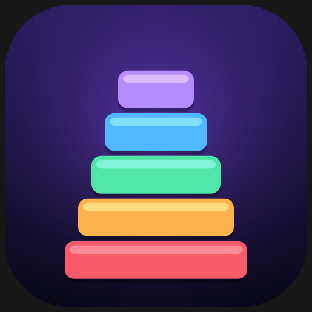

# Stack Tower

A tiny one-tap block-stacking arcade game for Android, written in **Godot 4.7** (GDScript).
No textures, no plugins, no external dependencies — every visual is drawn procedurally,
so the whole game is ~700 lines of code and builds in minutes.

<p align="center">
  
</p>

## Play

1. Open the [latest build release](../../releases/tag/latest-build) on your phone.
2. Download `stack-tower.apk` (~28 MB).
3. Install it (allow "install unknown apps" for your browser/file manager when asked).

Requires Android 7.0+ (minSdk 24), `arm64-v8a`.

## How to play

A block slides back and forth above the tower. **Tap anywhere** to drop it.

- Overhang gets sliced off and the tower narrows.
- Land within ~11 px of centre → **PERFECT**, the block keeps its full width and your combo grows.
- Miss completely (or leave a sliver thinner than 26 px) → game over.
- Your best score is stored locally (`user://stack_tower.cfg`).

The scoring block speed ramps up as you climb, and the palette shifts hue with every layer.
Haptics fire on perfect drops and game over.

## Project layout

```
project.godot              Godot project (portrait 1080x1920, GL Compatibility)
main.tscn                  Minimal scene: a Node2D with scripts/game.gd
scripts/game.gd            Game loop, placement math, scoring, audio, saves
scripts/block.gd           Procedurally drawn block (StyleBoxFlat, no textures)
scripts/hud.gd             Score, title screen, game over panel, popups
shaders/background.gdshader  Animated gradient background
tests/test_placement.gd    Headless unit tests for the placement math
tests/smoke.tscn/.gd       Headless integration test of the real game scene
tools/make_icons.py        Zero-dependency PNG generator for the launcher icons
export_presets.cfg         Android export preset (debug-signed APK)
.github/workflows/build.yml  CI: tests + APK build + release upload
```

## Building

### On GitHub Actions (how the APK in releases is made)

Every push to `main` and every `v*` tag runs `.github/workflows/build.yml`, which:

1. installs JDK 17 and Android SDK `platforms;android-35` + `build-tools;35.0.1`,
2. caches and installs Godot 4.7.2 + the official Android export templates,
3. points Godot at the SDK through `~/.config/godot/editor_settings-4.7.tres`,
4. runs the unit tests and the smoke test headlessly (a failure fails the build),
5. exports `build/stack-tower.apk` and verifies it with `aapt2`/`apksigner`,
6. uploads it as an artifact and attaches it to the `latest-build` pre-release
   (or to the tag's release for `v*` tags).

Trigger a build manually from the **Actions** tab (`workflow_dispatch`) or with:

```bash
gh workflow run build.yml
gh run watch
```

### Locally

Install Godot 4.7.2 (an ARM64 editor build works fine under Termux/proot for headless
work; Android SDK build-tools are x86_64-only, so exporting the APK is best left to CI):

```bash
# Run the tests without any GUI
godot --headless --path . --import
godot --headless --path . --script res://tests/test_placement.gd
godot --headless --path . res://tests/smoke.tscn

# Play on desktop (mouse click or Space = tap)
godot --path .
```

To export from your own machine, open the project in the editor, install the Android
export templates, set the SDK path in *Editor Settings → Export → Android*, and use
*Project → Export → Android*.

## Versioning a release

```bash
# bump the version in project.godot / export_presets.cfg, then:
git tag v1.1 && git push origin v1.1
```

That produces a normal (non-prerelease) GitHub release with the APK attached.

## Signing notes

The APK is **debug-signed**. CI uses a fixed keystore stored in the
`ANDROID_KEYSTORE_BASE64` repository secret, so consecutive builds share the same
signature and install over each other without uninstalling. If the secret is missing,
CI falls back to a throwaway keystore (you then have to uninstall before upgrading).

The same keystore is backed up outside the repo at `~/.config/stack-tower/debug.keystore`
(alias `androiddebugkey`, store/key password `android`). Keep it if you want future
builds to stay installable over the current one:

```bash
base64 -w0 ~/.config/stack-tower/debug.keystore \
  | gh secret set ANDROID_KEYSTORE_BASE64 --repo Xphinx-X/stack-tower
```

For a Play Store release you need a release keystore and an `.aab`:

```bash
keytool -genkeypair -v -keystore release.keystore -alias stacktower \
  -keyalg RSA -keysize 2048 -validity 10000
```

then set `gradle_build/use_gradle_build=true`, `gradle_build/export_format=1`, the
`keystore/release*` options, and export with `--export-release`. (Package name and
version live in `export_presets.cfg`.)

## Licence

MIT
